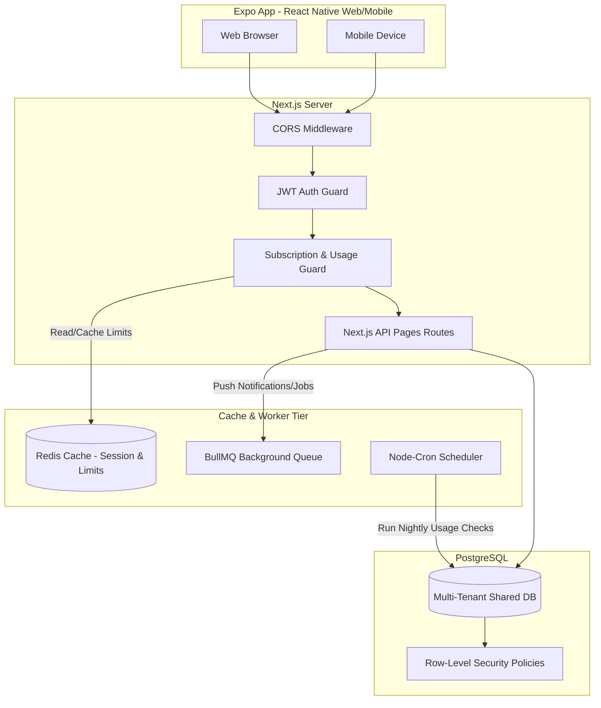
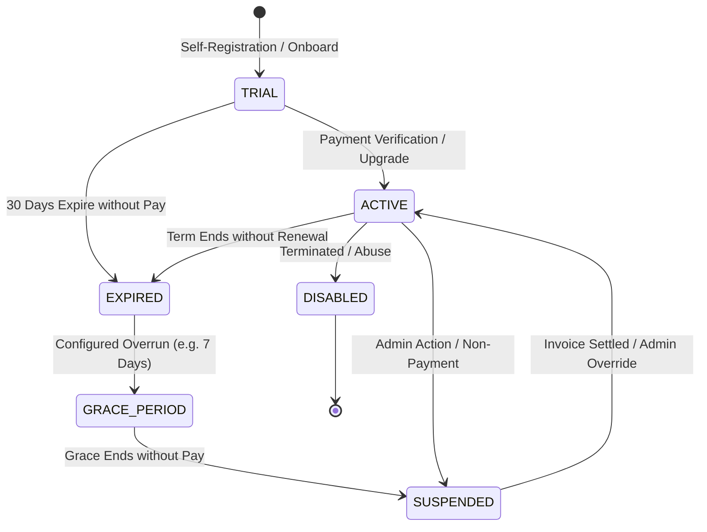
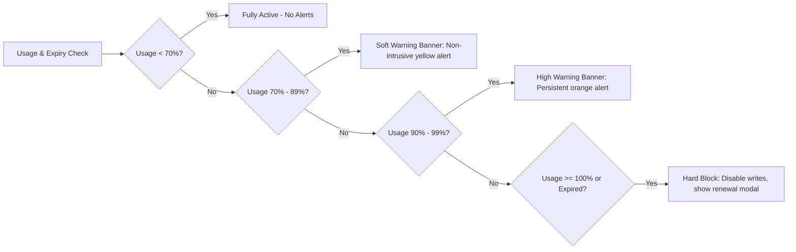
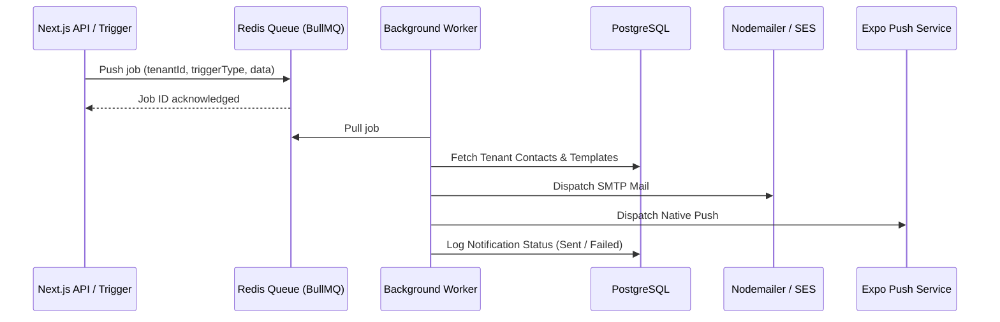
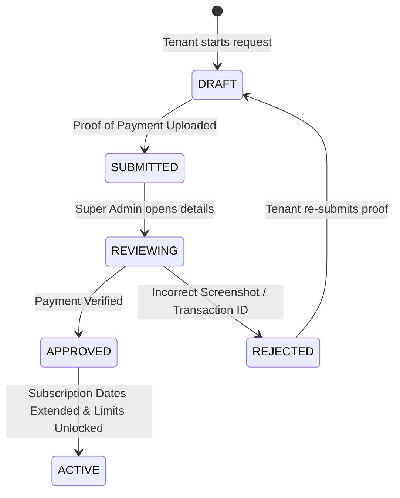
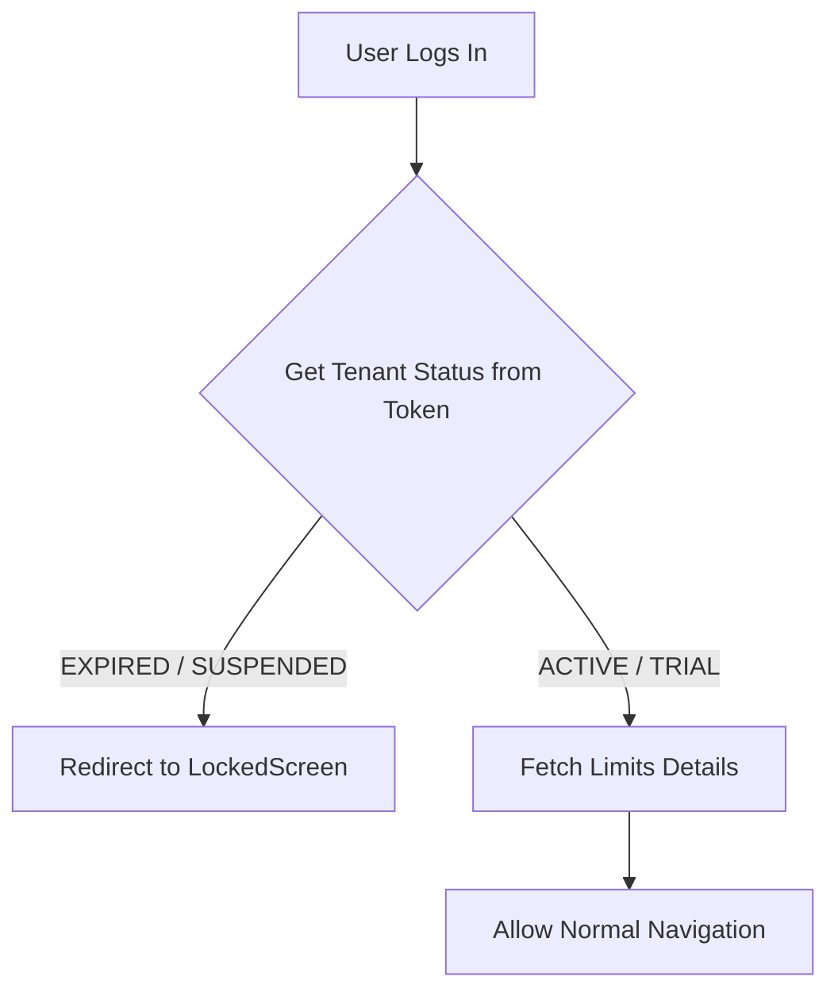
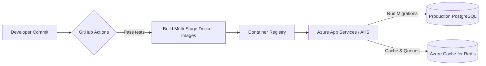
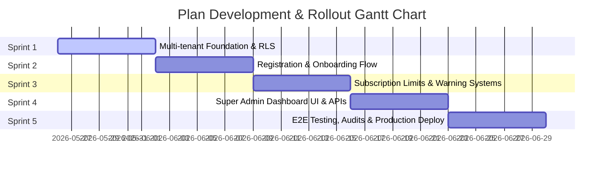

# Implementation Plan — Multi-Tenant Subscription & Super Admin Control System

This document outlines the complete architectural analysis, design, database migrations, security controls, API definitions, frontend screens, backend services, DevOps setups, and a phased execution roadmap for introducing a robust **Subscription Management + Super Admin Control System** to the **Asset Inventory App** monorepo.

---

## Goal Description

Introduce an enterprise-grade Multi-Tenant Subscription and Billing System that automatically enforces usage limits (users, assets, storage) and validity dates. Accompanying this is a comprehensive Super Admin Control System allowing full tenancy lifecycle control, billing verification, plan adjustments, override features, and system auditability.

---

## User Review Required

Please review the following high-priority decisions and design details:

> [!IMPORTANT]
> **1. Tenant Isolation Method (Logical Sharing)**
> We recommend a **Shared Database with Logical Isolation** (`tenantId` column and application-level query enforcement). Since your Prisma schema and tables (`Tenants`, `Users`, `Asset_Details`, etc.) are already designed with `tenantId` fields, this is the most natural fit. However, for high-compliance enterprise clients, we recommend introducing a hybrid model where **Enterprise** plans can be routed to a **Dedicated Database** via dynamic connection pool switching in backend middleware.
> Please confirm if logical isolation on a single DB is sufficient for starter/professional tiers.

> [!WARNING]
> **2. Auto-Restricting Write Access on Over-Limit**
> When a limit is hit (e.g. Max Assets exceeded), all *write* API endpoints (`POST`, `PUT`, `PATCH`) for assets will throw a `403 Forbidden` error with error code `LIMIT_EXCEEDED`, forcing the app to show a banner. Read operations (`GET`) will remain functional. Let us know if you want "soft limits" where users get a 3-day grace period to purchase upgrades before write access is blocked.

> [!CAUTION]
> **3. Mobile Registration Verification**
> Registration must block access until an organization is registered. On mobile, we will enforce a check upon login: if the user does not have a `tenantId` linked, or if their Tenant is marked as `PENDING_ONBOARDING`, they will be redirected to an onboarding flow. This requires changes in both the API login endpoint and the Expo router.

---

## Open Questions

> [!NOTE]
> - **Payment Processing**: For Indian markets, Razorpay or Cashfree is standard. For international, Stripe. Do you require real-time webhook-based PG integration in Sprint 3, or will a manual "Upload Bank Transaction Screenshot" workflow be sufficient for the initial launch? (We have fully documented *both* options below).
> - **Support Ticketing**: Will support tickets be stored in our internal DB, or do you plan to sync them with external services like Zendesk, Crisp, or Freshdesk in the future?

---

# Detailed Technical Architecture Design



---

## 1. Existing System Analysis

We have analyzed the current codebase of **Asset Inventory App**:
- **Monorepo Structure**: The repository contains `/packages/server` (Next.js with API endpoints) and `/packages/app` (an Expo React Native app supporting Android, iOS, and Web platform outputs via `react-native-web`).
- **Database Architecture**: Connects to a PostgreSQL database using a dual connection pattern:
  1. A direct Node-Postgres pool in `src/lib/db.ts` for raw parameterized queries.
  2. Prisma client (`schema.prisma`) configuration with `Tenants`, `Plans`, `Subscriptions`, `Roles`, `Users`, `Asset_Details`, `Asset_Assignments`, and EAV-style dynamic metadata tables (`AssetCategoryFields`, `AssetDynamicValues`).
- **Tenant Identification**: Tenants are modeled by the `Tenants` table. Tables like `Users`, `Asset_Details`, `Category`, `Status`, `Asset_Assignments`, and `Notifications` already have a nullable `tenantId` field to accommodate isolation.
- **Authentication**: JWT token based authentication (`src/lib/auth.ts`) which accepts a `tenantId` inside the signed payload.
- **Security & Scale Gaps**:
  1. **Query Leaks**: Several endpoints utilize raw SQL queries. A missing `tenantId` filter in any of these queries could cause cross-tenant data leakage.
  2. **Subscription Mock Only**: The UI has mock components, but no backend logic validates if the subscription is active, trial has ended, or max limits are exceeded before inserting/updating records.
  3. **Role Enforcement**: Roles are mapped by `Roles` table, but a proper role hierarchy checking engine is missing at the API handler level.

---

## 2. SaaS Multi-Tenant Architecture Design

### A. Tenant Isolation Strategy
We recommend a **Logical Database Isolation** approach with defense-in-depth measures:
- **Prisma Client Extension**: Utilize a Prisma Middleware or Client Extension to automatically inject `where: { tenantId: req.user.tenantId }` filters on all database queries.
- **Postgres Row-Level Security (RLS)**: Enforce RLS at the database tier.
  ```sql
  ALTER TABLE "Asset_Details" ENABLE ROW LEVEL SECURITY;
  CREATE POLICY tenant_isolation_policy ON "Asset_Details"
  USING ("tenantId" = current_setting('app.current_tenant_id', true));
  ```
  Every time a connection is retrieved from the pool, run `SET LOCAL app.current_tenant_id = '...'` in a transaction.

### B. Shared DB vs. Separate DB
- **Recommendation**: **Shared Database with Tenant Partitioning** for all Starter, Pro, and Trial tiers.
- **Rationale**: Highly cost-effective, straightforward schema migrations, easier global reporting.
- **Dedicated DB for Enterprise**: For enterprise tenants demanding high security, we recommend a secondary connection manager that resolves connection strings dynamically:
  ```typescript
  export async function getPrismaClient(tenantId: string) {
    const tenantDbUrl = await getTenantDatabaseUrl(tenantId);
    if (tenantDbUrl) {
      return new PrismaClient({ datasources: { db: { url: tenantDbUrl } } });
    }
    return defaultPrisma;
  }
  ```

### C. Tenant Lifecycle States



- **TRIAL**: Fully functional, limited to 30 days, max 100 assets, max 5 users.
- **ACTIVE**: Paid plan, full feature access, strict usage limits enforced.
- **EXPIRED**: Validity date passed. Read-only banner alerts displayed. Write access disabled.
- **GRACE_PERIOD**: Soft grace period (e.g., 7 days post-expiry) where write access remains enabled, but warning banners are persistent.
- **SUSPENDED**: Hard lockdown. Users cannot view details or log in (configurable). Banners display "Account Suspended - Contact Super Admin".
- **DISABLED**: Hard delete queue / archive state.

---

## 3. Super Admin Dashboard — Full Module Planning

A comprehensive control panel allowing total management of the platform:

| Module | Description | UI Components | API Endpoint |
| :--- | :--- | :--- | :--- |
| **Global Statistics** | Quick health metrics of SaaS. | HSL Line Graphs, count grids (Active Tenants, MRR, Server CPU). | `/api/superadmin/stats` |
| **Tenant Management** | Directory of all clients. | Paginated table with filters, quick search, "Impersonate Tenant" action. | `/api/superadmin/tenants` |
| **Subscription Management**| Audit active subscriptions. | Timeline view of expiring accounts, manual date override picker. | `/api/superadmin/subscriptions` |
| **Renewal Requests** | Review incoming tenant uploads. | Side-by-side transaction receipt image modal, Approve/Reject buttons. | `/api/superadmin/renewals` |
| **Billing Overview** | Tracks cashflow & invoices. | Multi-currency invoice list, download PDF button, export CSV. | `/api/superadmin/billing` |
| **Usage Analytics** | Tracks system volume limits. | Asset limit utilization progress bars, warnings for tenants hitting >90%. | `/api/superadmin/usage` |
| **Support Tickets** | Communication channel with tenants.| Split-screen support chat, custom canned replies, status dropdown. | `/api/superadmin/tickets` |
| **Notifications Center** | Global system broadcast. | Form to send global notifications or trigger specific tenant push alerts. | `/api/superadmin/notifications` |
| **Audit Logs** | System change tracker. | Chronological audit feeds (e.g., "User X modified Asset Y", "IP log"). | `/api/superadmin/audit` |
| **Payment Verification** | Receipt validation workflow. | Image viewer with OCR helper (if configured) to auto-verify txn IDs. | `/api/superadmin/payments` |
| **Feature Toggles** | Configures flags per tenant. | List of switches (e.g., "Enable Barcodes", "Enable SSO"). | `/api/superadmin/features` |
| **Plan Configuration** | CRUD for plans. | Form to set pricing, limits, storage, support priority level. | `/api/superadmin/plans` |
| **System Health** | Backend monitoring stats. | Database connection counts, cache hits, queue delays, cron status. | `/api/superadmin/health` |
| **Activity Monitoring** | Real-time session analytics. | Active user counts over the last 15 minutes, suspicious geolocation flags. | `/api/superadmin/activity` |

---

## 4. Subscription & Usage Limit System

### A. Subscription Plan Structure

```typescript
export interface PlanFeatures {
  storage: string;        // "2GB", "25GB", "100GB", "Unlimited"
  reports: 'basic' | 'standard' | 'advanced';
  support: 'email' | 'priority' | 'dedicated';
  qrCode: boolean;
  emailNotifications: boolean;
  apiAccess: boolean;
  customCategories: boolean;
  dynamicFields: boolean;
  auditLogs: boolean;
  roleManagement: boolean;
  sso?: boolean;
}
```

### B. Real-time Usage Tracking Design
We utilize a **Hybrid Database + Cache** pattern to prevent hammering PostgreSQL with count queries on every write:

1. **Redis Cache Counters**: Store tenant asset counts in Redis (e.g. key `tenant:{tenantId}:assets:count`).
2. **Increment on Create**: When a tenant uploads an asset, increment the counter.
3. **Decrement on Delete**: Decrement the counter when an asset is purged.
4. **Periodic Reconciliation**: A night cron job queries the SQL database to recount actual items and syncs the Redis cache to resolve drift:
   ```sql
   SELECT COUNT(id) FROM "Asset_Details" WHERE "tenantId" = $1;
   ```
5. **Storage Calculation**: Track total size of uploaded assets in bytes via `Asset_Details.photoURL` metadata in PostgreSQL and compare it to plan storage limits.

---

## 5. Restriction Logic & Warning Levels

To prevent sudden disruption of client operations, a three-phase notification and restriction protocol will be implemented:



### A. Warning Levels & Behavior
- **70% Threshold reached**: A subtle, dismissible banner displays in the dashboard dashboard (e.g., *"You've used 70% of your asset limit. Consider upgrading."*).
- **90% Threshold reached**: A persistent, orange banner displays across all screens. A system email is dispatched to the primary tenant contact.
- **100% Threshold reached / Expired (Soft Restriction)**: 
  - **Grace Period (7 Days)**: If a subscription ends, the tenant enters a grace period where write operations are still permitted, but an overlay modal alerts the admin at every login.
- **Hard Restriction (Active)**:
  - Disables the creation/editing of assets, assignments, and categories.
  - Blocks exports of inventory data to PDF or Excel.
  - Read-only operations are preserved so they can still browse active equipment.
  - Optionally blocks logins for non-admin accounts if the account is in a **SUSPENDED** state.

---

## 6. Notification System Design

A resilient multi-channel notification microservice will handle alerts:

### A. In-App and Email Queue Architecture



- **Queue Library**: `BullMQ` (backed by Redis) provides robust job scheduling, concurrency control, and auto-retry logic with exponential backoff.
- **Notification Triggers**:
  - `SUBSCRIPTION_EXPIRING_30_DAYS`, `15_DAYS`, `7_DAYS`, `1_DAY` (Sent to Tenant).
  - `USAGE_THRESHOLD_80`, `USAGE_THRESHOLD_95`, `LIMIT_EXCEEDED` (Sent to Tenant).
  - `RENEWAL_REQUEST_SUBMITTED`, `PAYMENT_PROOF_UPLOADED` (Sent to Super Admin).
  - `RENEWAL_APPROVED`, `RENEWAL_REJECTED` (Sent to Tenant).

---

## 7. Renewal Workflow



### A. Tenant Workspace Features
1. **Billing & Plan Center**: Shows active tier, validity, and usage stats.
2. **"Renew Plan" Flow**: A 3-step wizard:
   - **Step 1**: Select Target Plan (Starter, Professional, or Enterprise).
   - **Step 2**: Display payment instructions (Bank Transfer Details or QR Code).
   - **Step 3**: Form to paste **Transaction/Reference ID**, type remarks, and upload a screenshot of the payment receipt.
3. **Status Tracker**: Renders the current state of their request (`SUBMITTED`, `APPROVED`, or `REJECTED` with review feedback).

### B. Super Admin Approvals
1. **Renewal Queue Screen**: Displays all pending requests sorted by submission date.
2. **Review Action Drawer**:
   - Renders the uploaded screenshot with an image-zoom interface.
   - Shows the tenant name, current plan, requested plan, and the transaction ID.
   - Provides text input for rejection notes.
   - Buttons: **Approve** (commits transactions, extends DB validity, and sends email) and **Reject** (updates state, records reason, and alerts tenant).

---

## 8. Database Schema Design (PostgreSQL)

Here is the production-ready schema extensions mapped for Prisma:

```prisma
// ==========================================
// Tenant & Subscription Core
// ==========================================

model Tenants {
  id               String               @id @default(uuid())
  name             String
  organizationType String?
  institutionId    String?
  gstNumber        String?
  address          String?
  country          String?
  state            String?
  city             String?
  postalCode       String?
  status           String               @default("active") // "active", "expired", "suspended", "grace", "trialing", "disabled"
  createdAt        DateTime             @default(now())
  updatedAt        DateTime             @updatedAt

  users               Users[]
  subscriptions       Subscriptions[]
  Asset_Details       Asset_Details[]
  Category            Category[]
  Status              Status[]
  Asset_Assignments   Asset_Assignments[]
  Notifications       Notifications[]
  AssetCategoryFields AssetCategoryFields[]
  
  // Custom Extensions for SaaS Tracking
  renewalRequests     RenewalRequests[]
  payments            Payments[]
  invoices            Invoices[]
  auditLogs           AuditLogs[]
  featureFlags        TenantFeatureFlags[]
}

model Plans {
  id        String   @id
  name      String
  maxUsers  Int
  maxAssets Int
  maxStorage BigInt   @default(2147483648) // Default 2GB in bytes
  price     Decimal  @db.Decimal(10, 2)
  currency  String   @default("INR")
  features  Json?    // Stores granular feature access flags (e.g. qrCode: true)
  createdAt DateTime @default(now())

  subscriptions Subscriptions[]
}

model Subscriptions {
  id                     String    @id @default(uuid())
  tenantId               String
  planId                 String
  startDate              DateTime  @default(now())
  endDate                DateTime?
  status                 String    @default("trialing") // "active", "expired", "past_due", "canceled"
  paymentProvider        String?   // "manual", "stripe", "razorpay"
  providerSubscriptionId String?
  createdAt              DateTime  @default(now())
  updatedAt              DateTime  @updatedAt

  tenant Tenants @relation(fields: [tenantId], references: [id])
  plan   Plans   @relation(fields: [planId], references: [id])

  @@index([tenantId])
}

// ==========================================
// Billing & Renewal Workflows
// ==========================================

model RenewalRequests {
  id             String    @id @default(uuid())
  tenantId       String
  planId         String
  requestedDate  DateTime  @default(now())
  transactionId  String    @unique
  paymentProofUrl String
  remarks        String?
  status         String    @default("submitted") // "submitted", "reviewing", "approved", "rejected"
  rejectionReason String?
  reviewedBy     String?   // SuperAdmin User ID
  reviewedAt     DateTime?
  createdAt      DateTime  @default(now())
  updatedAt      DateTime  @updatedAt

  tenant Tenants @relation(fields: [tenantId], references: [id])
  
  @@index([tenantId])
  @@index([status])
}

model Payments {
  id            String   @id @default(uuid())
  tenantId      String
  amount        Decimal  @db.Decimal(10, 2)
  currency      String   @default("INR")
  status        String   @default("completed") // "pending", "completed", "failed", "refunded"
  paymentMethod String   // "bank_transfer", "upi", "card"
  transactionId String   @unique
  paymentDate   DateTime @default(now())
  createdAt     DateTime @default(now())

  tenant Tenants @relation(fields: [tenantId], references: [id])
  
  @@index([tenantId])
}

model Invoices {
  id          String   @id @default(uuid())
  tenantId    String
  invoiceNo   String   @unique // Auto-generated "INV-YYYY-XXXX"
  amount      Decimal  @db.Decimal(10, 2)
  tax         Decimal  @db.Decimal(10, 2) @default(0)
  total       Decimal  @db.Decimal(10, 2)
  status      String   @default("paid") // "unpaid", "paid", "voided"
  dueDate     DateTime
  paidDate    DateTime?
  pdfUrl      String?
  createdAt   DateTime @default(now())

  tenant Tenants @relation(fields: [tenantId], references: [id])
  
  @@index([tenantId])
}

// ==========================================
// System Governance & Customizations
// ==========================================

model TenantFeatureFlags {
  id          String   @id @default(uuid())
  tenantId    String
  featureKey  String   // "barcodes", "custom_categories", "sso", "dynamic_fields"
  isEnabled   Boolean  @default(false)
  updatedAt   DateTime @updatedAt

  tenant Tenants @relation(fields: [tenantId], references: [id])

  @@unique([tenantId, featureKey])
}

model AuditLogs {
  id         String   @id @default(uuid())
  tenantId   String
  userId     BigInt
  action     String   // "CREATE_ASSET", "LOGIN", "EXPORT_EXCEL", "RENEWAL_REQUEST"
  entityName String   // "Asset_Details", "Subscriptions"
  entityId   String?
  oldValue   Json?
  newValue   Json?
  ipAddress  String?
  userAgent  String?
  createdAt  DateTime @default(now())

  tenant Tenants @relation(fields: [tenantId], references: [id])
  
  @@index([tenantId, createdAt])
}

model SupportTickets {
  id          String   @id @default(uuid())
  tenantId    String
  userId      BigInt
  subject     String
  description String
  priority    String   @default("medium") // "low", "medium", "high", "critical"
  status      String   @default("open") // "open", "in_progress", "resolved", "closed"
  createdAt   DateTime @default(now())
  updatedAt   DateTime @updatedAt
  
  messages    SupportTicketMessages[]

  @@index([tenantId])
  @@index([status])
}

model SupportTicketMessages {
  id          String   @id @default(uuid())
  ticketId    String
  senderId    BigInt   // ID of User sending message
  isAgent     Boolean  @default(false) // True if sent by SuperAdmin
  message     String
  createdAt   DateTime @default(now())

  ticket SupportTickets @relation(fields: [ticketId], references: [id])
}
```

### B. Relational and Indexing Plan
To guarantee fast query execution even with millions of records across hundreds of tenants, we will implement these compound indices:
- **`Asset_Details`**: Index on `("tenantId", "categoryId", "status_id")` allows instant dashboard counts and filtered reads.
- **`Asset_Assignments`**: Index on `("tenantId", "operator_employeeId", "status")` ensures operators can retrieve their assignments quickly.
- **`AuditLogs`**: Compound Index `("tenantId", "createdAt")` for fast chronological log parsing.

---

## 9. API Design (Next.js Pages API Routes)

All endpoints utilize standard REST models. Input payloads will be rigorously validated using `Zod`.

### A. Super Admin APIs

#### 1. Retrieve Global Statistics
- **Route**: `GET /api/superadmin/stats`
- **Auth**: Required, Role = `SUPER_ADMIN`
- **Response**:
  ```json
  {
    "activeTenantsCount": 142,
    "pendingRenewalsCount": 8,
    "totalRevenueMonthly": 712000.00,
    "systemLoad": { "cpu": "24%", "memory": "62%" }
  }
  ```

#### 2. Process Renewal Request
- **Route**: `POST /api/superadmin/renewals/:requestId/action`
- **Auth**: Required, Role = `SUPER_ADMIN`
- **Request Body**:
  ```json
  {
    "action": "approve", // or "reject"
    "remarks": "Payment received via HDFC Bank. Transaction matched.",
    "overrideLimits": {
      "maxAssets": 5000 // Optional limit bump
    }
  }
  ```
- **Response**:
  ```json
  {
    "success": true,
    "message": "Renewal approved. Tenant upgraded to Professional.",
    "newExpiryDate": "2027-05-25T00:00:00Z"
  }
  ```

---

### B. Tenant / Subscription APIs

#### 1. Fetch Plan Usage & Subscription Status
- **Route**: `GET /api/subscription/status`
- **Auth**: Required, Any active Role. Scoped to caller `tenantId`.
- **Response**:
  ```json
  {
    "tenantId": "e1a90c1f-db90-410a-8bf8-0fb50fa89ad1",
    "companyName": "Naveen Survey and Constructions",
    "subscription": {
      "planId": "starter",
      "planName": "Starter Plan",
      "status": "active",
      "startDate": "2026-05-01T00:00:00Z",
      "endDate": "2027-05-01T00:00:00Z",
      "daysRemaining": 341
    },
    "limits": {
      "assets": { "used": 1240, "max": 2500, "percentage": 49.6 },
      "users": { "used": 12, "max": 25, "percentage": 48.0 },
      "storage": { "usedBytes": 12589990620, "maxBytes": 26843545600, "percentage": 46.9 }
    },
    "featureFlags": {
      "qrCode": true,
      "dynamicFields": false,
      "customCategories": false
    }
  }
  ```

#### 2. Submit Renewal Request
- **Route**: `POST /api/subscription/renew`
- **Auth**: Required, Role = `ADMIN`
- **Request Body**:
  ```json
  {
    "planId": "professional",
    "transactionId": "TXN9081256799",
    "paymentProofUrl": "https://asq-tenant-receipts.s3.amazonaws.com/proofs/txn_9081256799.jpg",
    "remarks": "Yearly professional plan payment uploaded."
  }
  ```
- **Response**:
  ```json
  {
    "success": true,
    "requestId": "50c822ff-654e-4b68-abdf-f7324c4e9766",
    "status": "submitted"
  }
  ```

---

## 10. Frontend Implementation Plan (Expo Web & Mobile)

Since `packages/app` is constructed in Expo, we must ensure our UI updates are completely cross-compatible, scaling gracefully from mobile screens to desktop browsers.

### A. protected Layout & Route Guards
We will introduce `SubscriptionGuard` inside the app's root navigation container (`/packages/app/src/navigation/index.tsx`).



- **Protected Layout Wrapper**: All administration views will wrap operations with a custom Hook `useSubscription()`. If the state resolves to restricted:
  - Disable Add Asset (`AddEditAsset.tsx`) forms. Render a persistent, overlay lock-screen graphic.
  - Render an un-dismissible **Lock Screen Modal** with contact details and a direct "Initiate Renewal" button.

### B. Premium Responsive Mockup Design — Renewal & Locked Screen

```carousel

<!-- slide -->

<!-- slide -->

```

1. **Dashboard Limit Widget**:
   - Modern Glassmorphic panel displaying circular HSL progress rings for **Assets**, **Users**, and **Storage**.
   - Rings transition dynamically: Cyan (`#06B6D4`) -> Orange (`#F97316`) -> Crimson (`#EF4444`) as limits are consumed.
2. **Renewal Center (SaaS Web Console & App view)**:
   - Beautiful cards showing **Starter**, **Professional**, and **Enterprise** options.
   - Elegant dark theme: Deep space blue (`rgba(7, 24, 42, 0.95)`) cards with glow effects (`box-shadow: 0 0 15px rgba(34,211,238,0.2)`).
   - Linear gradient buttons that trigger dynamic input forms for manual invoice processing.

---

## 11. Backend Implementation Plan

### A. Subscription Middleware Implementation
We will upgrade `packages/server/src/lib/apiHandler.ts` by appending subscription limit checks:

```typescript
import query from "@/lib/db";
import type { NextApiRequest, NextApiResponse } from 'next';
import { withAuth, AuthenticatedRequest } from "./apiHandler";

export interface TenantAccessRequest extends AuthenticatedRequest {
  tenantStatus: string;
  planLimits: {
    maxAssets: number;
    maxUsers: number;
  };
}

export const withSubscriptionCheck = (handler: any) => {
  return withAuth(async (req: AuthenticatedRequest, res: NextApiResponse) => {
    const { tenantId } = req.user;
    
    if (!tenantId) {
      return res.status(400).json({ message: "Tenant reference missing in token." });
    }

    // 1. Fetch Subscription details
    const subRes = await query(
      `SELECT t.status as "tenantStatus", p."maxAssets", p."maxUsers", s."endDate"
       FROM "Tenants" t
       LEFT JOIN "Subscriptions" s ON s."tenantId" = t.id AND s.status = 'active'
       LEFT JOIN "Plans" p ON p.id = s."planId"
       WHERE t.id = $1 LIMIT 1`,
      [tenantId]
    );

    if (!subRes.rows.length) {
      return res.status(403).json({ message: "No active tenant account found." });
    }

    const { tenantStatus, maxAssets, maxUsers, endDate } = subRes.rows[0];

    // 2. Block outright if status is Suspended or Expired
    if (tenantStatus === "suspended") {
      return res.status(403).json({
        code: "ACCOUNT_SUSPENDED",
        message: "Your organization access has been suspended. Please contact the Super Admin."
      });
    }

    if (tenantStatus === "expired" && (!endDate || new Date() > new Date(endDate))) {
      return res.status(403).json({
        code: "SUBSCRIPTION_EXPIRED",
        message: "Subscription has expired. Access is restricted to read-only."
      });
    }

    // 3. Inject constraints into request
    (req as any).tenantLimits = { maxAssets, maxUsers };
    
    return handler(req, res);
  });
};
```

---

## 12. Security Considerations

To protect data and prevent exploitation:
1. **No Client Side Injection**: `tenantId` is *never* accepted from request bodies for transactional queries. The API middleware extracts it exclusively from the cryptographically signed JWT.
2. **Data Leakage Mitigation**: Add automated Unit Tests checking SQL payloads. Run a linter that flags raw SELECT queries lacking `"tenantId" = $X` parameter checks.
3. **Secure File Uploads**: Ensure payment proof uploads (`.png`, `.jpeg`, `.pdf`) are restricted to a maximum size of 5MB, and utilize a secure AWS S3 / Azure Blob Storage signed-URL pattern, scanning files for embedded malware headers prior to persistence.
4. **Brute Force Prevention**: Add `express-rate-limit` (or Next.js API-level rate limiting using Upstash Redis) to block brute-force attempts on the Super Admin Login screen (`/api/superadmin/login`), restricting requests to 5 per minute per IP.

---

## 13. DevOps & Deployment Design



- **Containerization**: Dual-stage Docker files for both Next.js backend and Expo Web Server.
- **Queue/Worker Engine**: Run a separate Docker worker container dedicated solely to running `BullMQ` email and push notification dispatch scripts.
- **Disaster Recovery**: Automated nightly `pg_dump` backups pushed to encrypted cloud storage with a Point-in-Time Recovery (PITR) buffer of 14 days.

---

## 14. Recommended Tech Stack Improvements

- **Database Performance**: Introduce **PgBouncer** connection pooling to manage the high volume of transient Next.js API connections, avoiding the standard PostgreSQL limit exhaustion.
- **Monitoring & Metrics**: Implement **Prometheus** and **Grafana** dashboards overlaying database size, Redis queue delays, API latencies, and tenant warning triggers, giving Super Admins immediate system observability.

---

## 15. Phased Roadmap & Effort Estimation

We propose a structured, 5-week rollout plan:

### Sprint Breakdown



#### Sprint 1: Multi-Tenant Foundation (Effort: 35 Hours)
- Add schema tables via Prisma and run DB migrations.
- Build JWT signature updates supporting `tenantId`.
- Write the core Subscription Middleware.

#### Sprint 2: Onboarding & Registration (Effort: 40 Hours)
- Implement `/api/auth/register-tenant` transaction-safe endpoint.
- Design the mobile Expo Tenant Registration form.
- Embed system status checks on Login.

#### Sprint 3: Subscription Limits & Warnings (Effort: 45 Hours)
- Construct Redis limit counters and the daily recoup cron service.
- Integrate banner warning widgets and restriction modals inside the Expo layouts.
- Set up BullMQ background notifications queue.

#### Sprint 4: Super Admin Control Dashboard (Effort: 55 Hours)
- Code Super Admin API routing and authorization filters.
- Build the responsive 14-module dashboard view in the Expo Web platform.
- Integrate the payment proof review panel and manual invoicing tools.

#### Sprint 5: Hardening, E2E & Go-Live (Effort: 30 Hours)
- Run stress E2E testing scenarios (cross-tenant access denial check).
- Perform penetration tests (OWASP standards, secure uploads validation).
- Deploy staging builds to cloud containers, execute migrations, and go live.

---

## Verification Plan

We will verify all changes thoroughly through automated and manual protocols:

### Automated Tests
- **Isolation Tests**: Executing specific integration scripts that log in with Tenant A's token and try to edit an asset belonging to Tenant B (expects `404 Not Found` or `403 Forbidden`).
- **Limit Exhaustion Tests**: Scripts executing continuous POST requests to write assets until the limit is exceeded (expects exact `LIMIT_EXCEEDED` API response code).

### Manual Verification
- **Approval Flow Walkthrough**: Registering a test tenant, simulating expiry, uploading a custom billing receipt, viewing and approving the receipt inside the Super Admin panel, and confirming instant lock clearance on the tenant dashboard.
