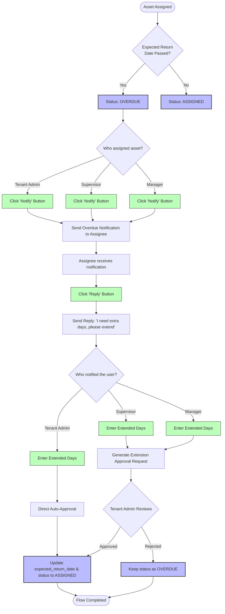

# Overdue Asset Extension Flow Chart

This flowchart describes the end-to-end process of overdue asset tracking, operator notification, extension requests, and the final approval flow.

---

## 1. Process Flowchart

---

## 2. Step-by-Step Description

| Step | Persona / System | Action | Description |
|---|---|---|---|
| **1** | **System** | Overdue Detection | Checks if `expected_return_date < NOW()`. If true, updates asset status to **OVERDUE**. |
| **2** | **Assigner** (Tenant Admin, Supervisor, Manager) | Notify User | Views the overdue asset on the dashboard and clicks **Notify**. An alert is sent to the assignee (Operator, Supervisor, or Manager). |
| **3** | **Assignee** (Operator, Supervisor, Manager) | Reply with Request | Receives the alert, clicks **Reply**, and enters: *"I need the asset for extra days, please extend."* |
| **4** | **Assigner** | Enter Extension | Receives the reply, enters the proposed number of extension days, and submits the request. |
| **5** | **Tenant Admin** | Review & Approve | Reviews the pending extension request. If approved, the system automatically updates the expected return date and resets the status back to **ASSIGNED**. |
