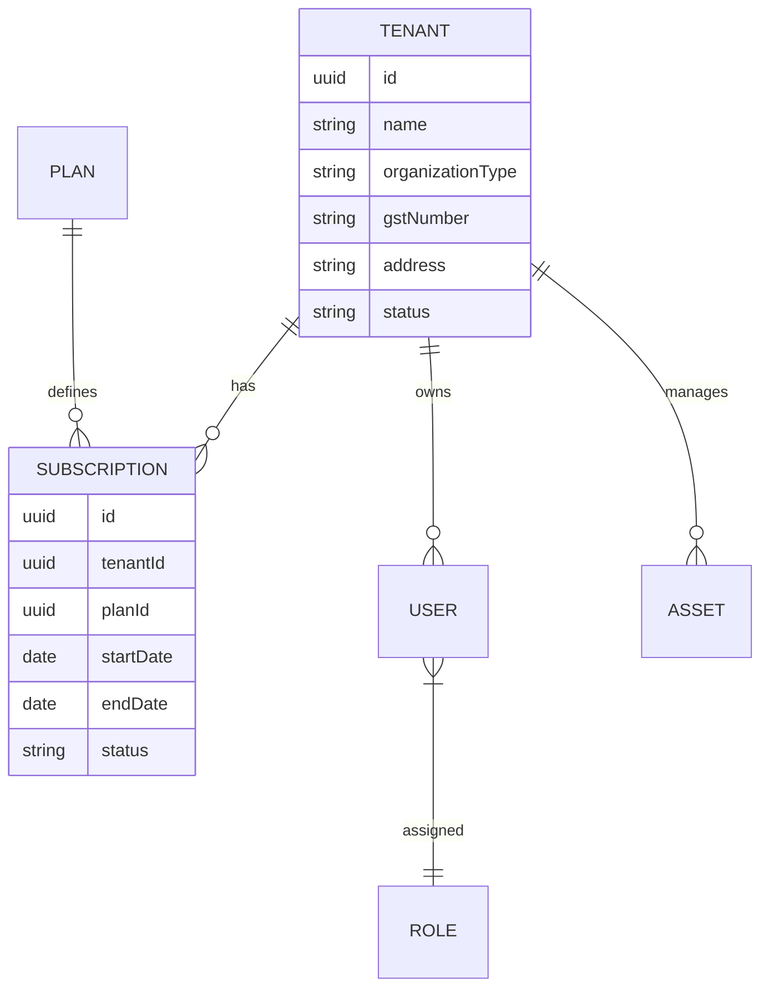

# SaaS Mobile App Registration & Multi-Tenant System: Analysis & Roadmap

This document provides a comprehensive analysis of the existing **Asset Inventory App** and outlines the architecture and implementation plan for transforming it into a scalable, multi-tenant SaaS platform.

---

## 1. Executive Summary
The current application is a high-performance asset management system but operates on a single-tenant model with basic authentication. To evolve into an enterprise SaaS, we must implement strict data isolation, subscription management, and a professional onboarding experience.

### Key Objectives
- **Mandatory Mobile Registration**: Block access until an organization is registered.
- **Multi-Tenancy**: Logical isolation of all data (Users, Assets, Transactions).
- **Subscription Engine**: Trial management, tiered plans, and payment integration.
- **Enterprise Security**: Hardened JWT, RBAC, and Audit Logs.

---

## 2. Technical Analysis & Gap Analysis

### A. Current Architecture Review
- **Backend**: Next.js (API Routes) with `pg` (direct SQL) and Prisma (partially used).
- **Frontend**: Expo (React Native) serving both mobile and web.
- **Database**: PostgreSQL with flat tables (`Users`, `Asset_Details`).
- **Auth**: Basic email/password check without JWT issuance in the current login flow.

### B. Gap Analysis
| Feature | Current State | Gap / Requirement |
| :--- | :--- | :--- |
| **Multi-Tenancy** | None (Flat tables) | Missing `Tenants` table and `tenantId` in all entities. |
| **Registration** | Basic User creation | Missing Organization creation, Admin assignment, and Subscription init. |
| **Subscription** | UI mockups only | Missing billing logic, expiry checks, and plan limits. |
| **RBAC** | Basic Roles table | Missing permission matrix and tenant-level role management. |
| **Security** | Simple Password Hash | Missing JWT Refresh tokens, MFA, and API Rate Limiting. |

---

## 3. Proposed SaaS Architecture

### A. Database Schema Updates (ER Diagram Concept)
We will introduce a `Tenant` as the root entity.



### B. Tenant Isolation Strategy
- **Logical Isolation**: Every table will include a `tenantId` column.
- **Global Middleware**: A backend middleware will extract `tenantId` from the JWT and inject it into every query.
- **Row-Level Security (RLS)**: (Optional recommendation) Use PostgreSQL RLS for an extra layer of protection.

---

## 4. Implementation Roadmap (5 Sprints)

### Sprint 1: Multi-Tenant Foundation
- [ ] **Database Migration**: Add `Tenants`, `Plans`, `Subscriptions` tables.
- [ ] **Schema Refactoring**: Add `tenantId` to all existing tables.
- [ ] **Auth Hardening**: Implement JWT with `tenantId` payload and Refresh Token rotation.
- [ ] **Base API**: Create `TenantAwareController` or middleware for query filtering.

### Sprint 2: Professional Onboarding
- [ ] **Registration API**: New endpoint `/api/auth/register-tenant` (Transaction-safe: Tenant + Sub + Admin).
- [ ] **Mobile Flow**: Redirect new users to Registration; implement OTP verification.
- [ ] **SSO Integration**: Google/Microsoft OAuth 2.0.

### Sprint 3: Subscription & Billing
- [ ] **Trial Engine**: Automatic 30-day trial activation on registration.
- [ ] **Payment Integration**: Razorpay/Stripe webhooks for auto-renew and billing.
- [ ] **Usage Guard**: Implement API-level checks for plan limits (e.g., Max 25 Assets for Trial).

### Sprint 4: Admin Portal & Management
- [ ] **User Management**: Invite users via email, RBAC assignment UI.
- [ ] **Billing Dashboard**: Invoice history, Plan upgrade/downgrade UI.
- [ ] **Advanced Reports**: Tenant-specific analytics and audit logs.

### Sprint 5: Hardening & QA
- [ ] **Security Audit**: SQL Injection, XSS, and Tenant leak testing.
- [ ] **E2E Testing**: Implement scenarios from `E2E_TEST_SCENARIOS.md` with multi-tenant context.
- [ ] **Performance**: Optimization for high-tenant counts (Indexing).

---

## 5. Security & Production Readiness Checklist

### Security
- [ ] All APIs decorated with `[Authorize]` (or equivalent Next.js middleware).
- [ ] `tenantId` never accepted from client body (always from JWT).
- [ ] Argon2 or Bcrypt (12+ rounds) for passwords.
- [ ] Rate limiting on Auth and Registration endpoints.

### Production
- [ ] Azure Key Vault for secrets.
- [ ] Database backups and PITR enabled.
- [ ] Monitoring (Sentry/Application Insights).
- [ ] Terms of Service & Privacy Policy acceptance logs.

---

## 6. API Documentation Draft

### Tenant Registration
`POST /api/auth/register-tenant`
**Payload:**
```json
{
  "organization": { "name": "...", "type": "...", "gst": "..." },
  "admin": { "name": "...", "email": "...", "password": "..." },
  "planId": "trial"
}
```

### Subscription Status
`GET /api/subscription/status`
**Response:**
```json
{
  "plan": "Starter",
  "expiry": "2026-06-14",
  "daysRemaining": 30,
  "usage": { "users": 1, "assets": 10 }
}
```
