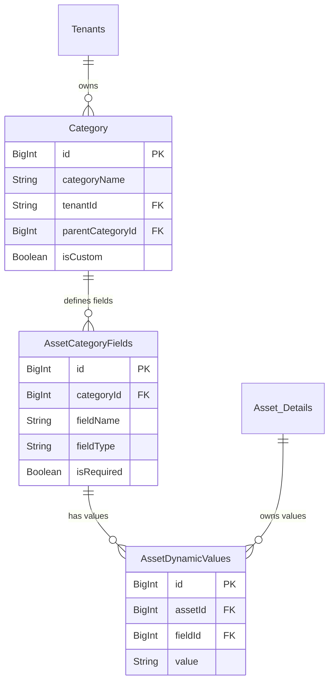

# SaaS Architecture & Implementation Plan: Tenant Customization & Migration

## A. Architecture Change Report

### 1. Tenant-Specific Asset Categories
Currently, the `Category` table has a `tenantId` field, but categories have been globally managed or implicitly shared. The new architecture enforces strict tenant isolation for categories.
- **IsCustom Flag**: Introduced to differentiate between default system categories and user-created ones.
- **Parent/Child Hierarchy**: Added `parentCategoryId` to allow hierarchical grouping.

### 2. Dynamic Asset Metadata (EAV Pattern)
To support different metadata needs per tenant (e.g., Construction vs. Healthcare), we are introducing an Entity-Attribute-Value (EAV) pattern.
- **AssetCategoryFields**: Defines the schema for custom fields per category (e.g., "Calibration Date" for Construction).
- **AssetDynamicValues**: Stores the actual values for these fields linked to specific assets.

### 3. Tenant Isolation
- **API Middleware**: All routes will extract `tenantId` from the JWT and inject it into Prisma queries.
- **Database Constraints**: `tenantId` becomes a required filter on all queries. Row Level Security (RLS) policies can be added at the PostgreSQL level for defense-in-depth.

---

## B. Database Migration Plan

We must migrate all existing production data to a new tenant: **Naveen Survey and Constructions (NSCLLP)**.

**Migration Steps:**
1. **Create Tenant**: Insert `NSCLLP` into the `Tenants` table.
2. **Assign Enterprise Subscription**: Create an Enterprise subscription for NSCLLP to accommodate existing high limits.
3. **Map Existing Users**: Update `Users` where `tenantId` IS NULL to point to NSCLLP's ID.
4. **Map Existing Categories**: Update `Category` and `Status` tables to belong to NSCLLP.
5. **Map Existing Assets**: Update `Asset_Details` and `Asset_Assignments` to point to NSCLLP.
6. **Map Notifications**: Update `Notifications` to point to NSCLLP.

---

## C. Updated ER Diagram (Relevant Portions)

---

## D. API Documentation Updates

### Category Management
- `POST /api/categories` - Create custom category. (Body: `name`, `parentId`, `icon`)
- `GET /api/categories` - List categories scoped to `req.user.tenantId`.
- `PUT /api/categories/:id` - Update custom category.

### Dynamic Fields
- `POST /api/categories/:categoryId/fields` - Add a custom field definition.
- `GET /api/categories/:categoryId/fields` - List fields for a category.
- `PUT /api/assets/:id/dynamic-values` - Upsert dynamic values for an asset.

---

## E. UI/UX Recommendations

1. **Category Builder**: A drag-and-drop interface in the Admin Portal to organize category hierarchies.
2. **Dynamic Form Renderer**: When adding an asset, selecting a category should dynamically fetch `AssetCategoryFields` and render appropriate inputs (DatePickers for `date`, TextInputs for `text`).
3. **Admin Dashboard**: Update charts to group by Custom Categories. Add "Subscription Limit Warnings" (e.g., progress bars showing 2,400 / 2,500 assets used).

---

## F. Security Review

- **Data Leakage Prevention**: Ensure no queries omit `where: { tenantId }`.
- **JWT Integrity**: Validate `tenantId` inside the signed JWT. Never trust a `tenantId` passed in the request body from the client.
- **Migration Safety**: Run the NSCLLP migration in a single atomic SQL transaction. If mapping fails midway, it rolls back entirely.

---

## G. Test Scenario Report

1. **Migration Test**: Ensure all legacy assets now have the NSCLLP `tenantId`. Log in with a legacy user and verify dashboard populates correctly.
2. **Isolation Test**: Create Tenant B. Attempt to fetch Tenant A's categories using Tenant B's JWT. Must return 404 or empty list.
3. **Dynamic Fields Test**: Create a "Biomedical Expiry" field. Save an asset with this field. Verify it persists and retrieves correctly.

---

## H. Rollback Strategy

Before running the migration script, a full pg_dump of the PostgreSQL database MUST be taken.
If the migration script causes orphaned records, restore the database from the snapshot. The application layer changes are backward compatible because the dynamic fields are additive.

---

## I. Production Deployment Checklist

- [ ] Take DB Snapshot.
- [ ] Deploy Prisma Schema Updates (`npx prisma db push` or `prisma migrate deploy`).
- [ ] Run NSCLLP Data Migration SQL Script.
- [ ] Deploy updated Backend API logic.
- [ ] Deploy updated Frontend Mobile/Web build.
- [ ] Run automated E2E tests for Tenant Isolation.
